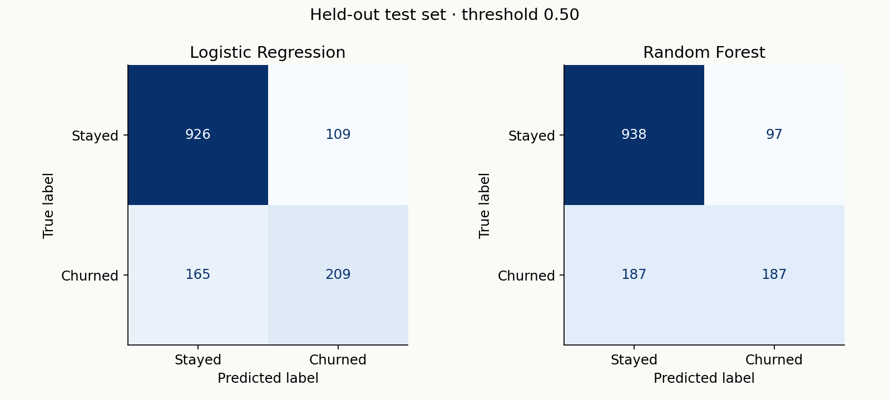
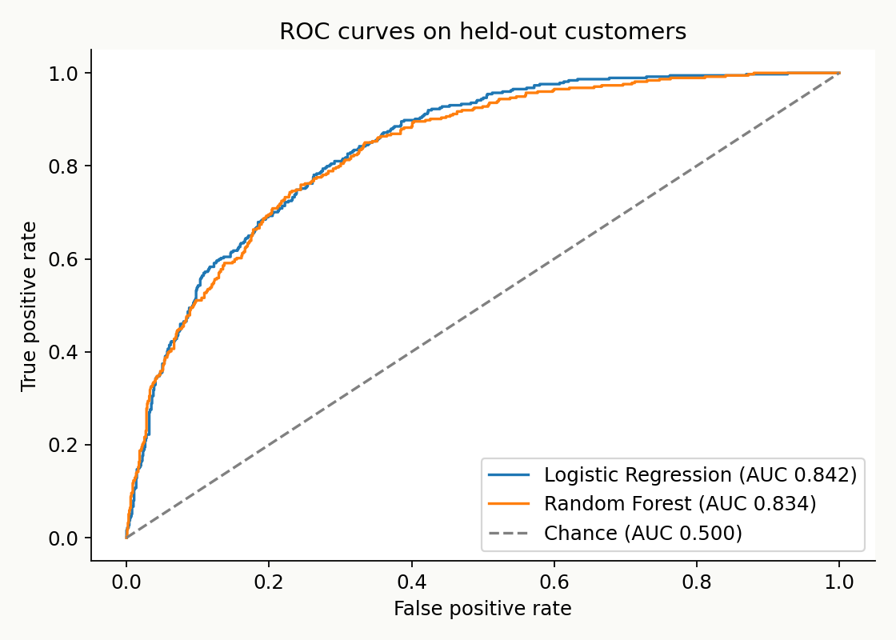
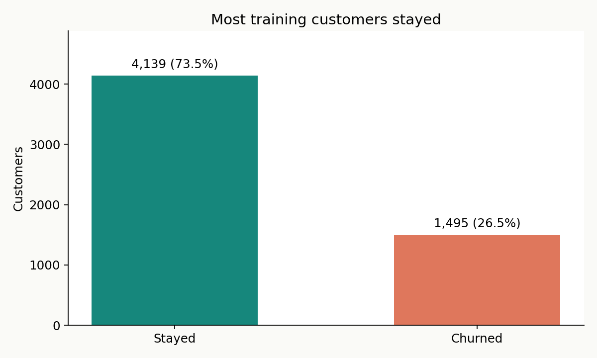
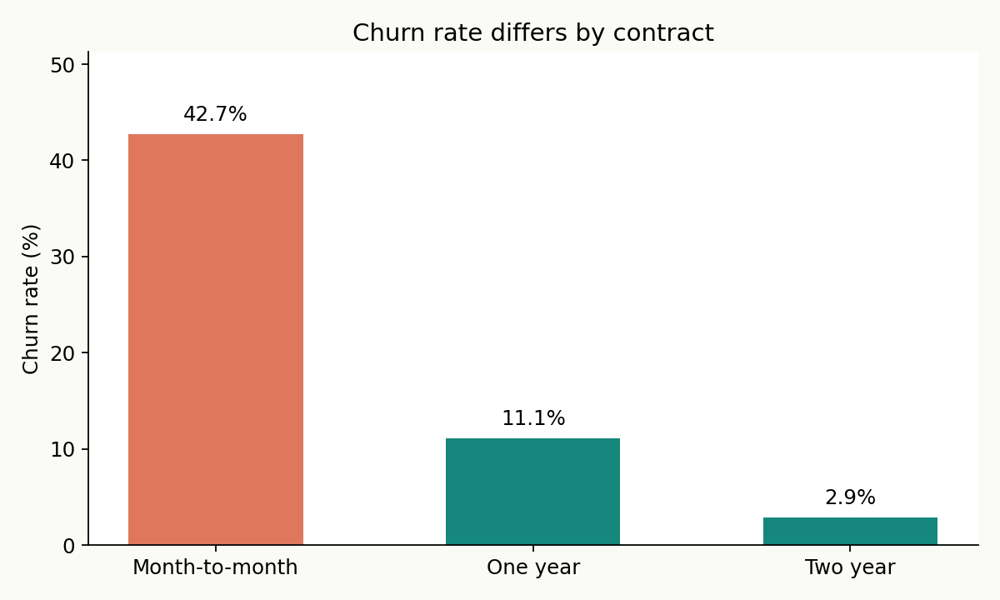
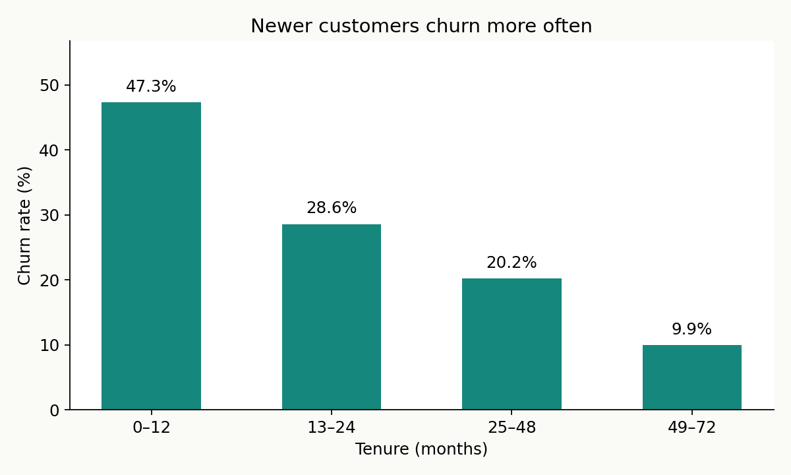
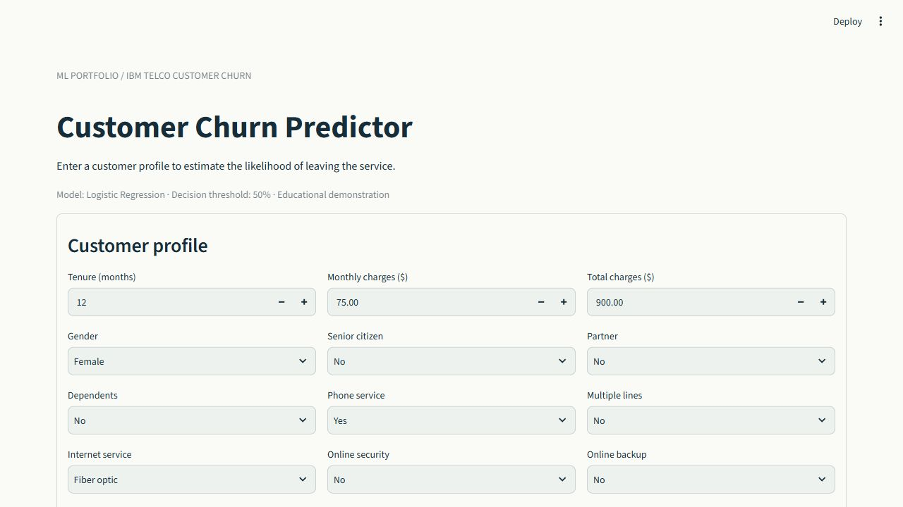
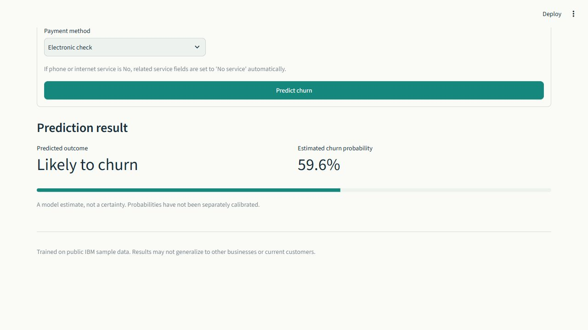

# Customer Churn Prediction

A small, reproducible machine learning project that predicts whether a telecom
customer is likely to leave the service. It covers data quality checks,
exploratory analysis, leakage-free preprocessing, two baseline models,
held-out evaluation, model persistence and a working Streamlit interface.

Built as an AI/ML internship portfolio project. All scores and charts below
come from executed training runs; screenshots show the running application.

## Dataset

**IBM Telco Customer Churn**: 7,043 customers, 21 original columns, 1,869 churned
customers (26.54%). Source: [IBM's public example repository](https://github.com/IBM/telco-customer-churn-on-icp4d)
and [original CSV](https://github.com/IBM/telco-customer-churn-on-icp4d/blob/master/data/Telco-Customer-Churn.csv).

The downloader pins revision `d5371f5d83a446ad5673cbcca3b814b926491f8a` and
checks SHA256 before use. The raw CSV is downloaded locally and excluded from
Git. See [dataset notes](data/README.md) and [machine-readable provenance](data/provenance.json).
No private customer data or invented training examples are used.

## Technologies

Python, Pandas, NumPy, Scikit-learn, Matplotlib, Streamlit, Joblib and pytest.
The verified environment is **Python 3.13.12 on Windows**. Runtime versions
are pinned in `requirements.txt`; `requirements-lock.txt` captures the complete
tested environment, including testing dependencies. No paid APIs or services.

## Preprocessing and evaluation design

1. Verify the dataset checksum, schema, target labels and unique customer IDs.
2. Remove `customerID`; map `Churn` from No/Yes to 0/1, with Yes as the positive class.
3. Make a stratified **80/20 split** with seed 42: **5,634 train / 1,409 test**.
4. Inside each pipeline, trim categorical strings and convert numeric fields.
   The raw CSV reports no nulls, but **11 blank `TotalCharges` values** become
   numeric missing values. All customers are retained.
5. Impute the three numeric fields (`tenure`, `MonthlyCharges`, `TotalCharges`)
   with training medians and standardize them. Impute the 16 categorical fields
   with their training modes and one-hot encode them. SeniorCitizen is categorical.
6. Fit preprocessing within a Scikit-learn `Pipeline` and `ColumnTransformer`,
   separately in each training fold. Unknown categories are ignored by the encoder.
7. Compare **Logistic Regression** (`max_iter=1000`) and **Random Forest**
   (`n_estimators=200`, `min_samples_leaf=2`) using identical three-fold
   stratified cross-validation on training data only.
8. Select by mean CV ROC-AUC **before inspecting test metrics**; exact ties favor
   Logistic Regression. Refit both models on train and evaluate on test at the
   fixed **0.50 threshold**. No tuning or threshold selection uses the test set.

The saved pipeline is the selected model fitted on the training partition,
so it is the same model whose held-out results are reported here. The test
partition is not used in the saved model's fit. EDA plots also use training data only.

## Actual model comparison

Executed on November 24, 2026. Precision, recall and F1 refer to **Churn=Yes**.
ROC-AUC uses positive-class probabilities. Higher is better for these metrics.

| Model | Train CV ROC-AUC | Test accuracy | Precision | Recall | F1 | Test ROC-AUC |
| --- | ---: | ---: | ---: | ---: | ---: | ---: |
| **Logistic Regression (saved)** | **0.8458 ± 0.0076** | **0.8055** | 0.6572 | **0.5588** | **0.6040** | **0.8419** |
| Random Forest | 0.8354 ± 0.0067 | 0.7984 | **0.6585** | 0.5000 | 0.5684 | 0.8343 |
| Majority baseline (always stay) | — | 0.7346 | 0.0000 | 0.0000 | 0.0000 | 0.5000 |

CV variation is the standard deviation across three folds, not a confidence
interval. The majority baseline shows why accuracy alone is insufficient for
this imbalanced dataset. Logistic Regression detects 209 of 374 churned test
customers and misses 165 at the fixed threshold.

Selected model confusion matrix (rows = actual, columns = predicted):

| | Predicted stay | Predicted churn |
| --- | ---: | ---: |
| Actual stay | 926 | 109 |
| Actual churn | 165 | 209 |




Full precision results: [metrics JSON](reports/metrics.json),
[comparison CSV](reports/model_comparison.csv),
[test labels and probabilities](reports/test_predictions.csv),
[saved split indices](reports/split.json), and [model metadata](models/metadata.json).
The predictions CSV allows the reported scores to be independently recalculated.

## Exploratory data analysis

These descriptive associations use the **5,634 training customers**; they do
not establish causation or estimate the effect of changing a contract.



Most customers stay. The overall source dataset contains 5,174 stayed and
1,869 churned customers; the stratified split preserves this class balance.



Training churn rates are **42.7%** for month-to-month contracts, **11.1%** for
one-year contracts and **2.9%** for two-year contracts.



Training customers with 0–12 months of tenure churn at **47.3%**, compared
with **9.9%** for 49–72 months. Exact rates and the missing-value audit are
saved in [EDA summary](reports/eda_summary.json) and [data audit](reports/data_audit.json).

## Streamlit application

Enter the 19 customer features and click **Predict churn**. The app loads the
saved Joblib pipeline and displays a class and estimated churn probability.
It validates input values and normalizes service-dependent fields: no phone
service means no multiple lines; no internet means no internet add-ons.

Actual input form:



Actual prediction for the default demonstration profile (12 months, $75 monthly,
$900 total, month-to-month contract): **59.6%**, predicted churn.



Changing tenure to 60 months, charges to $60 monthly / $3,600 total and contract
to Two year, with other fields unchanged, produces **7.8%**, predicted stay.
[See the second live result](docs/screenshots/app_prediction_stay.jpg).
These are manually entered demonstration profiles, separate from evaluation data.
Screenshots are unaltered browser captures, not mockups. Results refer to the last
submitted form; click Predict again after changing inputs.

## Install and reproduce

From the repository root, use Python **3.13** to reproduce the tested environment:

```powershell
python -m venv .venv
.\.venv\Scripts\Activate.ps1
python -m pip install -r requirements-lock.txt
python -m pip install --no-deps -e .
python -m churn.train
python -m pytest -q
python -m streamlit run app.py
```

On macOS/Linux, activate with `source .venv/bin/activate`. The source supports
Python 3.11+, but this release was verified on Windows/Python 3.13. For a fresh
environment with runtime pins and pytest, `pip install -r requirements-dev.txt`
is also available. A first download needs internet; training and inference run
locally once data and dependencies are present.

Open the URL printed by Streamlit (normally `http://127.0.0.1:8501`). If that
port is occupied, use `python -m streamlit run app.py --server.port 8502`.
No model is trained during application startup. If the model is absent, the
interface explains which training command to run. Only load trusted Joblib files.

Training automatically downloads and verifies the pinned CSV if absent, then
generates all EDA/evaluation plots, reports and the fitted model. Download alone:

```powershell
python -m churn.data
```

To rerun training and compare all CV scores, selected model and test metrics
against the preceding execution with absolute tolerance `1e-12`:

```powershell
python scripts/verify_reproducibility.py
```

This check overwrites generated reports/model with the new run. It passed in
the tested environment. Tiny numerical differences can occur across platforms
or library versions; use the recorded versions when comparing results.

## Verification evidence

- Both models completed three training CV folds and final train fits.
- Saved model predictions and probabilities matched after reload (`atol=1e-12`).
- **13 pytest tests passed**, covering dataset integrity, blank numeric values,
  deterministic disjoint splitting, train-only imputation statistics, unknown
  categories, invalid inputs, service dependencies, metric recalculation,
  persistence and real Streamlit form submission.
- A second complete training run reproduced model selection, every CV score
  and all test metrics within `1e-12`.
- Live browser form submissions verified both predicted classes and probabilities,
  matching direct calls to the saved model.
- Independent ChatGPT review inspected source, staged diffs and recorded test
  output and found no blocking implementation defects. Its review scope is
  documented in the execution evidence.

See [execution evidence](docs/C2C_EXECUTION.md) and the text records in
[`reports/verification/`](reports/verification/).

## Repository layout

```text
app.py                    Streamlit customer form
src/churn/data.py         Dataset integrity, schema and stateless cleaning
src/churn/model.py        Preprocessing Pipeline factory
src/churn/eda.py          Three training-only EDA charts
src/churn/train.py        CV selection, training, test evaluation and persistence
src/churn/predict.py      Input validation and saved model inference
tests/test_workflow.py    Small data/prediction/app test suite
scripts/                  Reproducibility verification
data/provenance.json      Original source, fixed revision and SHA256
models/                   Selected fitted pipeline and metadata
reports/                  Genuine metrics, audit, predictions and figures
docs/screenshots/         Unaltered captures from the running app
```

## Known limitations

- IBM's public sample is a small historical teaching dataset. It does not
  validate performance on current customers, other businesses or future periods.
- A random stratified split is used; there is no temporal or external validation.
- At threshold 0.50, selected-model recall is 55.9%; many churn cases are missed.
  Threshold/cost analysis would need a separate validation design.
- Probabilities have not been separately calibrated. They are estimates, not
  guaranteed likelihoods; no business ROI or retention uplift is measured.
- Demographic features come from the source schema; fairness is not evaluated.
  The demo supports the dataset's categories and numeric ranges, which do not
  cover every real customer profile.
- No extensive tuning, production deployment or monitoring is included.
  This is a local portfolio demonstration, not a commercial decision system.

## CV bullet points

- Built a reproducible customer churn pipeline for 7,043 IBM Telco records using Pandas and Scikit-learn, with stratified splitting and preprocessing fitted within training folds.
- Compared Logistic Regression and Random Forest using three-fold cross-validation; the selected model achieved 0.8419 ROC-AUC and 80.55% accuracy on 1,409 held-out customers.
- Developed a Streamlit app using a saved Joblib pipeline to predict churn probabilities, with 13 passing tests and verified training reproducibility.

## License

Project source code: [MIT](LICENSE). IBM dataset ownership and source terms
remain with the original publisher; the raw dataset is not redistributed here.
